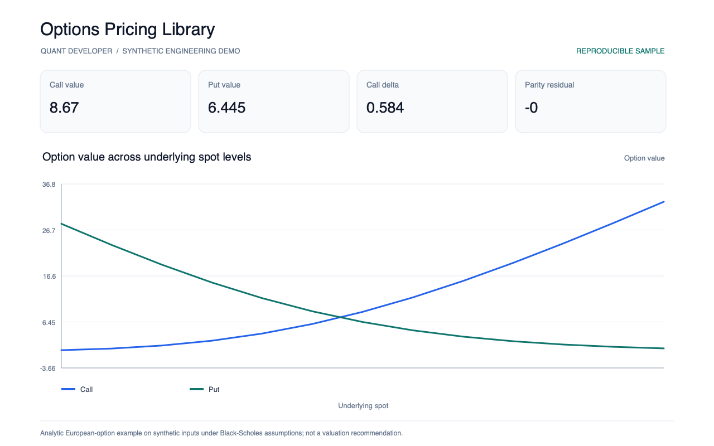
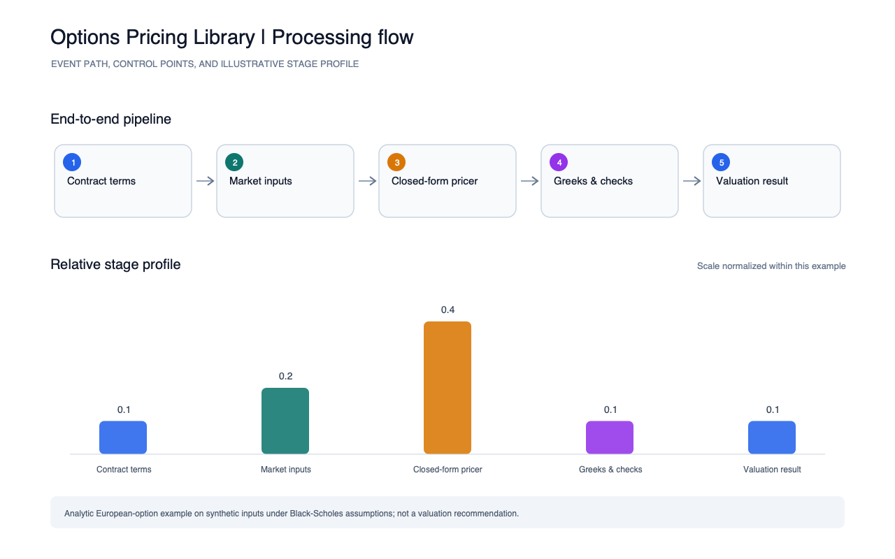

# Options Pricing Library

A dependency-free European option pricing example using the Black-Scholes-Merton closed form, analytic delta and vega, and a put-call parity check.

Run `python3 run.py` to write `reports/metrics.json`. The chart compares call and put values over underlying spot levels.

Run the smoke test with `python3 -m unittest discover -s tests -v`. The report images were generated from these metrics by the portfolio's shared screenshot script.

The example assumes European exercise, constant volatility and rates, and idealized model inputs; it is not a valuation recommendation.
